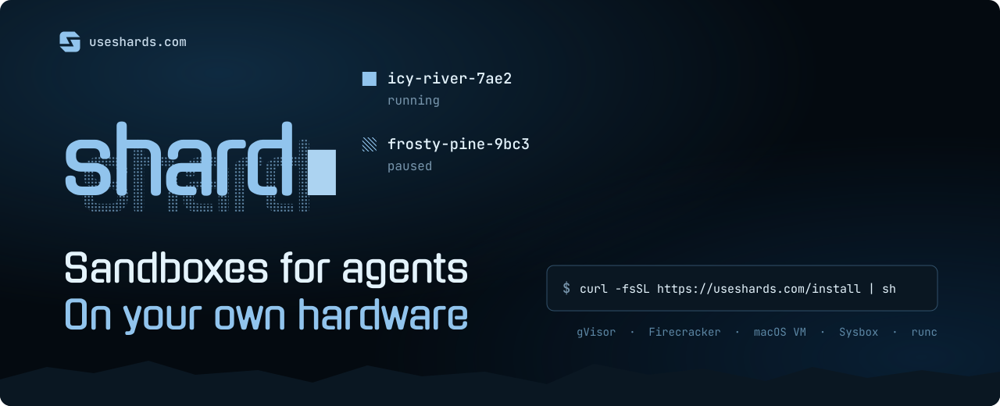
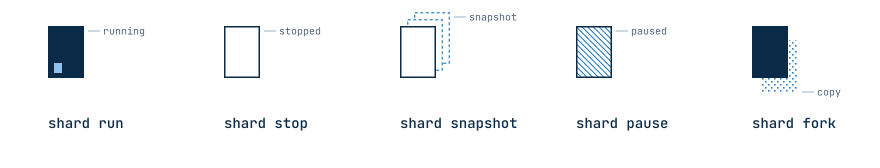

<div align="center">
  <a href="https://useshards.com"></a>

  <br><br>

  <a href="https://github.com/presmihaylov/shard/releases"></a>
  <a href="https://www.npmjs.com/package/useshards"></a>
  <a href="https://pypi.org/project/useshards/"></a>
  <a href="LICENSE"></a>

  <p>
    <a href="https://useshards.com"><b>Website</b></a> &nbsp;·&nbsp;
    <a href="https://useshards.com/docs"><b>Docs</b></a> &nbsp;·&nbsp;
    <a href="https://useshards.com/docs/sdks/typescript/"><b>TypeScript SDK</b></a> &nbsp;·&nbsp;
    <a href="https://useshards.com/docs/sdks/python/"><b>Python SDK</b></a>
  </p>
</div>

<br>

**shard gives each agent an isolated sandbox on a machine you control.** Create one from an OCI image,
run commands in it, pause it, snapshot it, or fork it into a copy. The CLI, the REST API and the
TypeScript and Python SDKs share one set of verbs.

<p>
&nbsp;&nbsp;<b>Pick your isolation</b>: gVisor, Firecracker microVMs, macOS VMs, Sysbox or runc, behind the same commands.<br><br>
&nbsp;&nbsp;<b>Your own hardware</b>: a Linux server or an Apple silicon Mac. No cloud account needed.<br><br>
&nbsp;&nbsp;<b>Pause, resume, fork</b>: freeze a sandbox with its memory, pick it up later, or copy a running one.<br><br>
&nbsp;&nbsp;<b>Snapshots</b>: save a stopped sandbox's files and start new sandboxes from them.<br><br>
&nbsp;&nbsp;<b>Credential brokering</b>: the sandbox sees a placeholder, and the host puts the real key into HTTPS headers for the destinations you approve.<br><br>
&nbsp;&nbsp;<b>Egress control</b>: allow and deny rules per sandbox. Private networks, cloud metadata included, are always blocked.<br><br>
&nbsp;&nbsp;<b>Supervised processes</b>: <code>shard run</code> keeps named processes alive, and the sandbox outlives them all.<br><br>
&nbsp;&nbsp;<b>Ports</b>: forward a host port to a port inside a sandbox.<br><br>
&nbsp;&nbsp;<b>One API</b>: the CLI and the SDKs speak to the same daemon, on this machine or over <code>shard serve</code>.
</p>

<p align="center">
  <picture>
    <source media="(prefers-color-scheme: dark)" srcset=".github/assets/lifecycle-dark.svg">
    
  </picture>
</p>

## &nbsp;&nbsp;Getting Started

#### Install the CLI

> ```sh
> curl -fsSL https://useshards.com/install | sh
> ```

The installer puts `shard` in `~/.local/bin` and needs no root. When `~/.local/bin` is not on your
`PATH`, it prints the line that adds it.

#### Set up the host

> ```sh
> shard setup
> ```

The installer offers to start this wizard for you. It checks the host, recommends a provider, and
installs the provider's tools and the daemon. Nothing changes until you confirm. Answer `Yes` to start
shard at boot. To script it:

> ```sh
> shard setup --local --provider gvisor --start-at-boot=true -y
> ```

On a Mac, use `--provider vz`.

#### Install an SDK

> ```sh
> npm install useshards   # TypeScript
> pip install useshards   # Python
> ```

> **Requirements**
>
> | Host | Providers |
> | --- | --- |
> | Linux, x86_64 | gVisor, Sysbox, runc, and Firecracker with `/dev/kvm` |
> | macOS 14 or later, Apple silicon | vz |
>
> On Windows, run shard inside WSL 2. An Intel Mac can connect to a remote host, but cannot run sandboxes.

> [!WARNING]
> shard is pre-alpha. Commands, flags, the API and the SDKs can change in any release.

## &nbsp;&nbsp;CLI

#### Run a command

> ```sh
> sudo shard create --name demo --memory 512MiB alpine:3.20
> sudo shard exec demo echo hello
> sudo shard shell demo
> sudo shard remove --force demo
> ```

On Linux the daemon's socket belongs to root, so local commands take `sudo`. On a Mac the daemon runs
as you, so leave it out. The rest of this page leaves `sudo` out.

#### Supervised processes

A sandbox starts with no processes. `shard run` starts a named one, which shard-init supervises and
restarts when it exits.

> ```sh
> shard create --name web python:3.12
> shard run web --name api -- python3 -m http.server 8000
> shard ps web
> shard logs web api
> ```

#### Forward a port

> ```sh
> shard port add web 9000:8000
> curl http://127.0.0.1:9000
> ```

#### Pause, resume and fork

> ```sh
> shard pause web
> shard resume web
> shard fork --name web2 web
> ```

A fork copies the source's memory and files into a new sandbox, and the source keeps running. gVisor,
Firecracker and vz support these three verbs. Sysbox and runc refuse them. `shard capabilities` says
what your host supports.

#### Snapshots

> ```sh
> shard stop web
> shard snapshot create --name web-base web
> shard create --name web3 --snapshot web-base
> ```

A snapshot holds files, not memory. It outlives the sandbox it came from.

#### Secrets and network policy

> ```sh
> printf '%s' "$GITHUB_TOKEN" | shard secret set --destination api.github.com GITHUB_TOKEN
> shard policy create --allow api.github.com github-only
> shard create --name agent --secret GITHUB_TOKEN --policy github-only alpine:3.20
> shard exec agent sh -c 'echo $GITHUB_TOKEN'
> shard policy logs agent
> ```

The sandbox sees `mock-GITHUB_TOKEN`. In HTTPS request headers to `api.github.com`, the host puts the
real value in its place. The policy denies every other destination, and `shard policy logs` shows each
decision.

#### Inspect

> ```sh
> shard list
> shard inspect web
> shard capabilities
> ```

> [!TIP]
> Every command takes `--help`, with its options and an example.

<a href="https://useshards.com/docs/reference/cli/"></a>

## &nbsp;&nbsp;SDK

The SDKs talk to `shard serve`, the HTTP front that checks an API key and passes each request to the
daemon. Answer `Yes` to `Set up the HTTP API?` in `shard setup`, then mint a key on the host, with
`sudo` on Linux:

> ```sh
> shard tokens mint --name my-agent --duration 24h
> ```

Its `token` field is the API key. On the machine that runs your code:

> ```sh
> export SHARD_REMOTE=https://shard.example.com
> export SHARD_API_KEY=<the token>
> ```

```ts
import { Shard } from "useshards";

const shard = new Shard();
const sandbox = await shard.create({ image: "alpine:3.20", name: "demo" });
try {
  const result = await sandbox.exec(["echo", "hello"]);
  console.log(result.exitCode, result.stdout);

  await sandbox.files.write("/tmp/hello.txt", "hello\n");
  console.log((await sandbox.exec("cat /tmp/hello.txt")).stdout);
} finally {
  await sandbox.remove({ force: true });
  shard.close();
}
```

<details>
<summary><b>Python</b></summary>

```python
from useshards import Shard

with Shard() as shard:
    sandbox = shard.create("alpine:3.20", name="demo")
    try:
        result = sandbox.exec(["echo", "hello"])
        print(result.exit_code, result.stdout)

        sandbox.files.write("/tmp/hello.txt", "hello\n")
        print(sandbox.exec("cat /tmp/hello.txt").stdout)
    finally:
        sandbox.remove(force=True)
```

`AsyncShard` has the same verbs for asyncio.

</details>

<a href="https://useshards.com/docs/sdks/typescript/"></a>
<a href="https://useshards.com/docs/sdks/python/"></a>

## &nbsp;&nbsp;Guides

- [Run an agent's code in a sandbox](https://useshards.com/docs/guides/run-agent-code/)
- [Give a sandbox an API key safely](https://useshards.com/docs/guides/api-key/)
- [Lock down network access](https://useshards.com/docs/guides/network/)
- [Fork a sandbox to try two paths](https://useshards.com/docs/guides/fork/)
- [Keep state between commands](https://useshards.com/docs/guides/keep-state/)
- [Move files in and out](https://useshards.com/docs/guides/files/)
- [Run Docker inside a sandbox](https://useshards.com/docs/guides/docker/)
- [Connect to a remote host](https://useshards.com/docs/guides/remote/)
- [Run shard on a Mac](https://useshards.com/docs/guides/mac/)
- [Run shard on a KVM host](https://useshards.com/docs/guides/kvm/)

<a href="https://useshards.com/docs"></a>

## &nbsp;&nbsp;Contributing

Read [AGENTS.md](AGENTS.md) for the code layout and contribution rules. Install the `golangci-lint`
version that [CI](.github/workflows/ci.yml) pins, then run `make check` before each commit. It runs
the format check, vet, lint, the unit tests, and the e2e script's own tests. Tests that need a
runtime, namespaces, or KVM carry the `integration` build tag and run on a host that has them. See
[the release guide](docs/release.md) for the platform checks.

## &nbsp;&nbsp;License

[Apache-2.0](LICENSE). See [NOTICE](NOTICE) for attribution.
