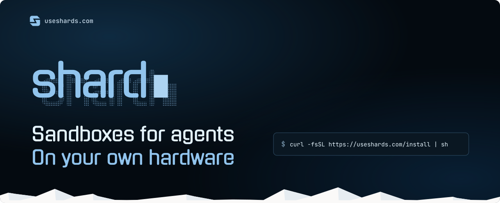

<div align="center">
  <a href="https://useshards.com"></a>

  <br><br>

  <a href="https://github.com/presmihaylov/shard/releases"></a>
  <a href="https://www.npmjs.com/package/useshards"></a>
  <a href="https://pypi.org/project/useshards/"></a>
  <a href="LICENSE"></a>

  <p>
    <a href="https://useshards.com"><b>Website</b></a> &nbsp;·&nbsp;
    <a href="https://useshards.com/docs"><b>Docs</b></a> &nbsp;·&nbsp;
    <a href="https://useshards.com/docs/sdks/typescript/"><b>TypeScript SDK</b></a> &nbsp;·&nbsp;
    <a href="https://useshards.com/docs/sdks/python/"><b>Python SDK</b></a>
  </p>
</div>

<br>

<p><b>shard runs sandboxes for AI agents on your own hardware.</b></p>

<p>A sandbox is an isolated computer where an agent can install packages, run code and break things without touching anything else. You choose how strong the walls are:</p>

<ul>
<li><b>Containers</b> for speed</li>
<li><b>MicroVMs</b> when you need a hard boundary</li>
</ul>

<p>Either way, it's the same commands and API, on a Linux server or a Mac Mini.</p>

<p>
&nbsp;&nbsp;<b>Pick your isolation</b>: gVisor, Firecracker microVMs, macOS VMs, Sysbox or runc, behind the same commands.<br><br>
&nbsp;&nbsp;<b>Your own hardware</b>: a Linux server or a Mac Mini. No cloud account needed.<br><br>
&nbsp;&nbsp;<b>Pause, resume, fork</b>: freeze a sandbox with its memory, pick it up later, or copy a running one.<br><br>
&nbsp;&nbsp;<b>Snapshots</b>: save a stopped sandbox's files and start new sandboxes from them.<br><br>
&nbsp;&nbsp;<b>Credential brokering</b>: the sandbox sees a placeholder, and the host puts the real key into HTTPS headers for the destinations you approve.<br><br>
&nbsp;&nbsp;<b>Egress control</b>: you pick which hosts a sandbox is allowed to talk to.<br><br>
&nbsp;&nbsp;<b>Long-running processes</b>: keep services up, with restarts and health checks built in.<br><br>
&nbsp;&nbsp;<b>Expose ports</b>: running a web server, API or preview app in a sandbox? Map it to a port on the host and it's reachable from the internet.<br><br>
&nbsp;&nbsp;<b>One API</b>: the CLI and the SDKs speak to the same daemon, on this machine or over <code>shard serve</code>.<br><br>
&nbsp;&nbsp;<b>SDKs</b>: TypeScript and Python, with the same verbs as the CLI.
</p>

<p align="center">
  
</p>

## &nbsp;&nbsp;Getting Started

#### Install the CLI

```sh
curl -fsSL https://useshards.com/install | sh
```

#### Set up the host

```sh
shard setup
```

The guided setup picks the right provider for your hardware and installs everything, asking before it changes anything.

Setting up headlessly, say on a server or in CI? Pass the answers as flags:

```sh
# Linux server, sandboxes in gVisor, starts at boot
shard setup --local --provider gvisor --start-at-boot=true -y

# Linux with /dev/kvm, sandboxes in Firecracker microVMs
shard setup --local --provider firecracker --start-at-boot=true -y

# Apple silicon Mac, sandboxes in macOS VMs
shard setup --local --provider vz --start-at-boot=true -y
```

#### Install an SDK

```sh
npm install useshards   # TypeScript
pip install useshards   # Python
```

**Requirements**

| Host | Providers |
| --- | --- |
| Linux, x86_64 | gVisor, Sysbox, runc, and Firecracker with `/dev/kvm` |
| macOS 14 or later, Apple silicon | vz |

**Limitations**

On Windows, run shard inside WSL 2. An Intel Mac can connect to a remote host, but cannot run sandboxes.

<picture>
  <source media="(prefers-color-scheme: dark)" srcset=".github/assets/box-warning-dark.svg">
  
</picture>

## &nbsp;&nbsp;CLI

#### Run a command

```sh
sudo shard create --name demo --memory 512MiB alpine:3.20
sudo shard exec demo echo hello
sudo shard shell demo
sudo shard remove --force demo
```

#### Supervised processes

A sandbox starts with no processes. `shard run` starts a named one, which shard-init supervises and restarts when it exits.

```sh
shard create --name web python:3.12
shard run web --name api -- python3 -m http.server 8000
shard ps web
shard logs web api
```

#### Forward a port

```sh
# Start a sandbox and serve a page from it on port 8000
shard create --name site python:3.12
shard exec site sh -c 'mkdir -p /srv && echo "hello from shard" > /srv/index.html'
shard run site --name http -- python3 -m http.server 8000 --directory /srv

# Expose it on port 9000 of the host
shard port add site 9000:8000

curl http://127.0.0.1:9000
# hello from shard
```

#### Pause, resume and fork

```sh
# Start a sandbox and leave some state in it
shard create --name demo alpine:3.20
shard exec demo sh -c 'echo "still here" > /tmp/note'

# Freeze it, then pick it up where it left off
shard pause demo
shard resume demo
shard exec demo cat /tmp/note
# still here

# Copy the running sandbox; the original keeps running
shard fork --name demo2 demo
shard exec demo2 cat /tmp/note
# still here
```

A fork copies the source's memory and files into a new sandbox, and the source keeps running. gVisor, Firecracker and vz support these three verbs. Sysbox and runc refuse them. `shard capabilities` says what your host supports.

#### Snapshots

```sh
# Set up a sandbox once, then stop it
shard create --name base alpine:3.20
shard exec base sh -c 'echo "baked in" > /etc/motd'
shard stop base

# Save its files as a snapshot
shard snapshot create --name base-snap base

# Start a fresh sandbox from the snapshot
shard create --name copy --snapshot base-snap
shard exec copy cat /etc/motd
# baked in
```

A snapshot holds files, not memory. It outlives the sandbox it came from.

#### Secrets and network policy

```sh
# Store your GitHub token on the host, usable only for api.github.com
printf '%s' "$GITHUB_TOKEN" | shard secret set --destination api.github.com GITHUB_TOKEN

# Allow api.github.com and nothing else
shard policy create --allow api.github.com github-only

# Start a sandbox with the secret and the policy
shard create --name agent --secret GITHUB_TOKEN --policy github-only alpine:3.20

# The sandbox only ever sees a placeholder
shard exec agent sh -c 'echo $GITHUB_TOKEN'
# mock-GITHUB_TOKEN

# Yet an authenticated call to GitHub works: the host swaps in the real token
shard exec agent sh -c 'wget -qO- --header "Authorization: Bearer $GITHUB_TOKEN" https://api.github.com/repos/torvalds/linux | grep "\"full_name\""'
#   "full_name": "torvalds/linux",

# Any other destination is blocked
shard exec agent wget -qO- https://example.com
# fails: example.com is not in the policy

# See every allow and deny decision
shard policy logs agent
```

The sandbox sees `mock-GITHUB_TOKEN`. In HTTPS request headers to `api.github.com`, the host puts the real value in its place. The policy denies every other destination, and `shard policy logs` shows each decision.

#### Inspect

```sh
# Start a sandbox to look at
shard create --name web --memory 512MiB python:3.12

# Every sandbox on this host, one per line, with its state (running, paused, stopped)
shard list

# Everything about one sandbox: its image, provider, resources, state,
# forwarded ports, and the secrets and policy attached to it
shard inspect web

# What this host supports: its providers, and which verbs (pause, fork) each allows
shard capabilities
```

<picture>
  <source media="(prefers-color-scheme: dark)" srcset=".github/assets/box-tip-dark.svg">
  
</picture>

**[CLI docs →](https://useshards.com/docs/reference/cli/)**

## &nbsp;&nbsp;SDK

#### Connect from another machine

Mint an API key on the host, and any machine with that key can drive your sandboxes: from the CLI, an SDK or plain HTTP.

Turn on the HTTP API during `shard setup`, then mint a key on the host:

```sh
shard tokens mint --name my-agent --duration 24h
```

Its `token` field is the API key. On the machine that runs your code:

```sh
export SHARD_REMOTE=https://shard.example.com
export SHARD_API_KEY=<the token>
```

The CLI on that machine now talks to your host:

```sh
shard create --name remote-demo alpine:3.20
shard exec remote-demo echo hello
# hello
```

#### Use an SDK

The SDKs read the same two variables, so the code below runs on your laptop and its sandboxes run on the host.

##### TypeScript

```ts
import { Shard } from "useshards";

const shard = new Shard();
const sandbox = await shard.create({ image: "alpine:3.20", name: "demo" });

const result = await sandbox.exec(["echo", "hello"]);
console.log(result.stdout); // hello

await sandbox.files.write("/tmp/hello.txt", "hi from a file\n");
console.log((await sandbox.exec("cat /tmp/hello.txt")).stdout); // hi from a file

await sandbox.remove({ force: true });
shard.close();
```

**[TypeScript SDK docs →](https://useshards.com/docs/sdks/typescript/)**

##### Python

```python
from useshards import Shard

with Shard() as shard:
    sandbox = shard.create("alpine:3.20", name="demo")

    result = sandbox.exec(["echo", "hello"])
    print(result.stdout)  # hello

    sandbox.files.write("/tmp/hello.txt", "hi from a file\n")
    print(sandbox.exec("cat /tmp/hello.txt").stdout)  # hi from a file

    sandbox.remove(force=True)
```

`AsyncShard` has the same verbs for asyncio.

**[Python SDK docs →](https://useshards.com/docs/sdks/python/)**

## &nbsp;&nbsp;Guides

- [Run shard on a Mac](https://useshards.com/docs/guides/mac/)
- [Run shard on a Linux server with KVM](https://useshards.com/docs/guides/kvm/)
- [Run shard on a Linux server without KVM](https://useshards.com/docs/guides/linux/)
- [Run Docker inside a sandbox](https://useshards.com/docs/guides/docker/)
- [Connect to a remote host](https://useshards.com/docs/guides/remote/)
- [Run an agent's code in a sandbox](https://useshards.com/docs/guides/run-agent-code/)
- [Run a web service in a sandbox](https://useshards.com/docs/guides/web-service/)
- [Give a sandbox an API key safely](https://useshards.com/docs/guides/api-key/)
- [Lock down network access](https://useshards.com/docs/guides/network/)
- [Fork a sandbox to try two paths](https://useshards.com/docs/guides/fork/)
- [Move files in and out](https://useshards.com/docs/guides/files/)

**[All docs →](https://useshards.com/docs)**

## &nbsp;&nbsp;Contributing

Contributions are welcome. For anything bigger than a small fix, open an issue first so we can talk it through. Before sending a pull request, run the checks:

```sh
make check
```

## &nbsp;&nbsp;License

[Apache-2.0](LICENSE). See [NOTICE](NOTICE) for attribution.
