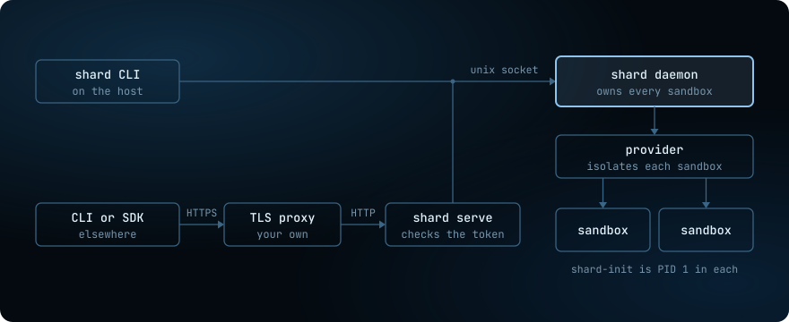

A daemon on the host owns every sandbox. The CLI and the SDKs are its clients: the CLI on the host reaches it over a unix socket, and a CLI or SDK on another machine reaches it through `shard serve`.

Almost every shard command is a request to the daemon, and you can send the same request yourself:

```sh
# Prints the daemon's version and API version as JSON.
curl --unix-socket /var/lib/shard/shard.sock http://localhost/v0/version
```

A few commands work without a daemon: `shard setup`, `shard daemon` itself, `shard serve`, `shard info`, the `shard tokens` commands that mint, list and revoke tokens, help and `--version`. `shard daemon status` shows the version, the provider, the process details and the background tasks of the daemon that answers.

## The parts



| Part | What it does |
| --- | --- |
| `shard` CLI | Sends commands to the daemon and prints the answer. It holds no sandbox state. |
| TypeScript and Python SDKs | Send the same requests from your program, through `shard serve`. |
| `shard serve` | Checks the bearer token of each request, then passes the bytes to the daemon's socket. |
| `shard daemon` | Owns every sandbox, image, snapshot, secret and policy, and runs every command on them. |
| Provider | Isolates each sandbox: `runsc` for gVisor, `sysbox-runc`, `runc`, one `firecracker` process per sandbox, or one Virtualization.framework VM per sandbox on a Mac. |
| `shard-init` | Runs as PID 1 inside every sandbox. It starts and supervises the processes that `shard run` names, and stays up. |

## The daemon

The daemon is the only process that writes the sandbox records, the images, the snapshots, the secrets and the policies. Every command on them, local or remote, goes through it, so these stores need no lock between processes. It keeps them under `/var/lib/shard` by default. `shard daemon --root` selects another data directory.

- **One daemon per data directory.** It takes a lock on `daemon.lock` there, and a second daemon on the same directory refuses to start.
- **One daemon per Linux host.** Every data directory shares the sandbox bridge and its nft table, so a daemon on a second directory refuses to start while another one runs.
- **Root on Linux, your user on a Mac.** On a Mac, your user owns the data directory.

The daemon runs these background tasks. `shard daemon status` lists them:

| Task | What it does |
| --- | --- |
| `api` | Serves the REST API on `shard.sock`. |
| `proxy` | The egress proxy on the gateway of the sandbox network. For a sandbox with a policy or a secret, it judges each HTTP and HTTPS request by host name. It puts a secret value into the headers of an HTTPS request only when the secret is granted to that destination. |
| `dns` | Answers DNS lookups for every sandbox that has a policy. |
| `egress-log-tailer` | Copies the host's records of dropped packets into each sandbox's egress log. |
| `liveness` | Every 5 seconds, checks each running sandbox against the provider and corrects the record. |
| `firewall` | Every 5 seconds on Linux, puts back the host firewall accepts for the sandbox bridge that a reload of ufw or iptables flushes. |
| `processes` | Every second, copies the state, restarts and last exit of each process onto its sandbox's record, which `shard ps` reads. |
| `ports` | Every second, listens on each host port forwarded into a running sandbox, and closes the rest. Each connection goes to the sandbox through its provider. |
| `autostart` | Once per daemon start, after the `proxy`, `dns` and `firewall` tasks are up, starts the sandboxes and processes whose restart policy brings them back. |
| `held-log-rotation` | Caps each output log that the runtime writes at about 16 MiB, and keeps one older file. |
| `log-reopen` | Reopens the daemon's own log file, if `shard daemon --log` names one. |

A failed task restarts after a backoff of up to one minute.

## A sandbox outlives the daemon

Sandboxes that already run normally survive a daemon restart.

A sandbox also outlives its processes. When one exits, the sandbox stays `running`, and `shard ps` shows the exit. `shard stop` ends the sandbox without deleting its files. A forced remove, a host shutdown or a runtime failure can also end it.

## Remote access

The daemon never serves its API on TCP. That keeps the API behind the socket's file permissions, and a caller from the network always meets a token check first. To reach the daemon from another machine, run `shard serve` on the same host. `shard serve` listens on `127.0.0.1:7850` by default, behind a proxy that terminates TLS. For each request, it:

1. Reads the request line and the headers.
2. Rejects the request unless the token is valid and its scopes cover the route.
3. Connects to the daemon, adds the token's scopes as a header, and asks the daemon to close the connection after the answer.
4. Passes the body and the answer on unchanged.

On Linux, a non-root user needs membership in the `shard` group to reach the socket. Without that group, only root can reach it. On a Mac, run `shard serve` as the daemon's user.

The CLI picks the daemon in this order:

1. `--remote <url>`, or `SHARD_REMOTE`.
2. The connection that `shard setup` saved.
3. Otherwise, the local daemon's socket.

For a remote connection, the CLI uses `SHARD_API_KEY` first. Otherwise, it uses the saved key only when the selected URL names the saved server. An explicit `--remote ""` selects the local socket and ignores the saved connection.

The SDKs use a remote URL and API key from constructor options or the environment variables `SHARD_REMOTE` and `SHARD_API_KEY`. They ignore the saved connection and always go through `shard serve`.
