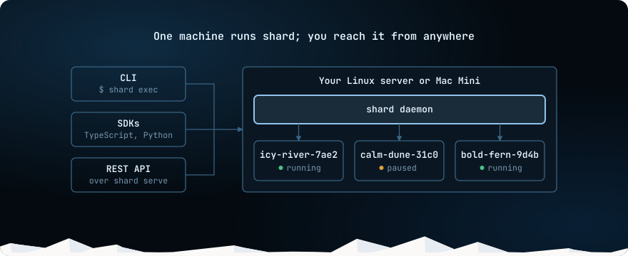
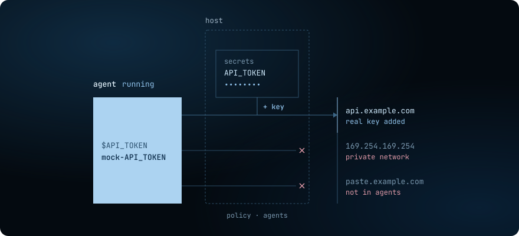

import { LinkCard, TabItem, Tabs } from '@astrojs/starlight/components';

shard runs sandboxes for AI agents on hardware you own. A sandbox is an isolated Linux environment
where an agent can run code, install packages and use the network, kept apart from the machine it
runs on. You host shard yourself, on a Linux server or an Apple silicon Mac, with no cloud account.

Create a sandbox, write a file in it, read the file back, and remove the sandbox:

<Tabs syncKey="lang">
<TabItem label="CLI">

```sh
# Create a sandbox from the alpine image.
shard create --name demo --memory 512MiB alpine:3.20

# Write a file in it.
shard exec demo sh -c 'echo hello from shard > /tmp/hello.txt'

# Prints hello from shard.
shard exec demo cat /tmp/hello.txt

# Remove the sandbox.
shard remove --force demo
```

</TabItem>
<TabItem label="TypeScript">

```ts
import { Shard } from 'useshards';

const shard = new Shard();

// Create a sandbox from the alpine image.
const sandbox = await shard.create({
  image: 'alpine:3.20',
  name: 'demo',
  memoryMiB: 512,
});
try {
  // Write a file in it.
  await sandbox.files.write('/tmp/hello.txt', 'hello from shard\n');

  // Prints hello from shard.
  console.log((await sandbox.exec('cat /tmp/hello.txt')).stdout);
} finally {
  // Remove the sandbox.
  await sandbox.remove({ force: true });
  shard.close();
}
```

</TabItem>
<TabItem label="Python">

```python
from useshards import Shard

with Shard() as shard:
    # Create a sandbox from the alpine image.
    sandbox = shard.create("alpine:3.20", name="demo", memory_mib=512)
    try:
        # Write a file in it.
        sandbox.files.write("/tmp/hello.txt", "hello from shard\n")

        # Prints hello from shard.
        print(sandbox.exec("cat /tmp/hello.txt").stdout)
    finally:
        # Remove the sandbox.
        sandbox.remove(force=True)
```

</TabItem>
</Tabs>

Each tab prints `hello from shard`.

## How you connect to it



One machine runs shard and all of its sandboxes. Everything else reaches them through one API: the
`shard` CLI, the [TypeScript](/docs/sdks/typescript/) and [Python](/docs/sdks/python/) SDKs, or
your own code over [HTTP](/docs/reference/api/).

On that machine the CLI works as soon as setup
ends. Another machine, such as your laptop or a CI job, connects over HTTPS with an API key.

## What a sandbox is

A sandbox starts from an image, such as `alpine:3.20`, and keeps running until you stop or remove it. `create` starts
no process in it.

`run` starts a named process that shard supervises and can start again, and
`exec` runs a one-off command. A process can exit, and the sandbox stays available for `exec`. The
image's `ENTRYPOINT` and `CMD` never run.

| Verb | What it does |
|---|---|
| `stop`, `start` | Stop frees the memory and keeps the files. Start uses those files and starts the processes whose restart policy brings them back. |
| `pause`, `resume` | Pause saves the memory and the files. Resume continues the processes from that state. |
| `fork` | Copies a running sandbox's memory and files into a new sandbox. The source pauses briefly, then continues. |
| `snapshot create` | Saves a stopped sandbox's files, without its memory. A snapshot outlives its sandbox and can seed new ones. |
| `remove` | Deletes the sandbox and its files. |

To try each verb step by step, start with [Create a sandbox, run commands and move files](/docs/essentials/run-commands/).

## Providers

A provider is the isolation technology under every sandbox on a host. One host runs one provider.

| Provider | Isolation | `pause`, `resume`, `fork` |
|---|---|---|
| `firecracker` | A microVM per sandbox. Needs `/dev/kvm`. | yes |
| `gvisor` | A user-space kernel, `runsc`. | yes |
| `vz` | A VM per sandbox on a Mac, through Virtualization.framework. | yes, on Apple silicon with macOS 14 or later |
| `sysbox` | Linux user namespaces. The sandbox can run Docker inside. One tenant per host. | no |
| `runc` | Linux namespaces on the host kernel, with no user namespace. Only for code you trust. | no |

`shard setup` recommends Firecracker when `/dev/kvm` is usable, gVisor on Linux without it, and
`vz` on a Mac. A verb that a provider does not support fails with an error that names the provider.
shard never falls back to a weaker mechanism.

To pick one for your host, see [What provider should I pick?](/docs/choose-provider/).

## Secrets and network access

The host decides what each sandbox can reach and which keys it can use:

- **Network egress control.** A policy lists the destinations a sandbox may reach, and the host
  drops the rest. Private networks and cloud metadata are always blocked.
- **Credential brokering.** You store a key on the host and grant it to a destination. The sandbox
  gets a placeholder, and the host puts the real key into HTTPS requests to that destination, in
  flight. Code in the sandbox never sees the key, so it cannot leak it.



You can still pass a key into a sandbox yourself, with `--env`, but then the code in it can read
the key. [Secrets](/docs/security/secrets/) and [Network egress](/docs/security/egress/) have the
details.

## What shard is not

shard manages one host. It does not schedule sandboxes across a fleet.

## Next steps

<LinkCard title="Install" description="Install the shard CLI with one command." href="/docs/install/" />
